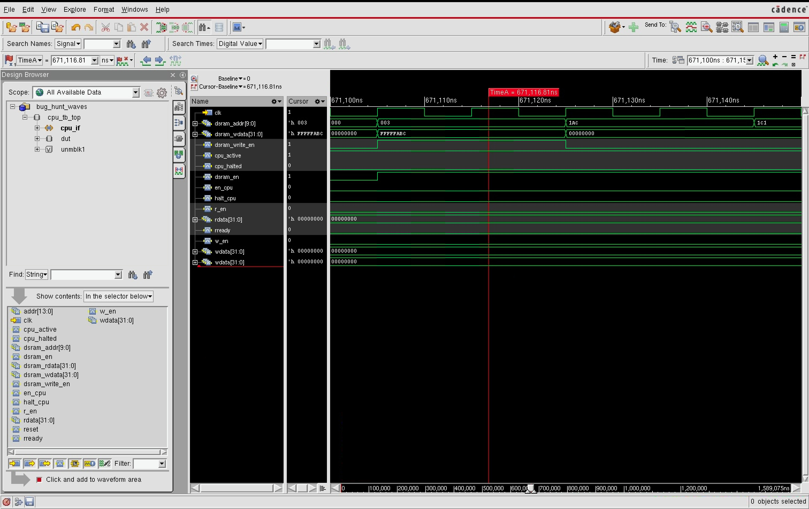
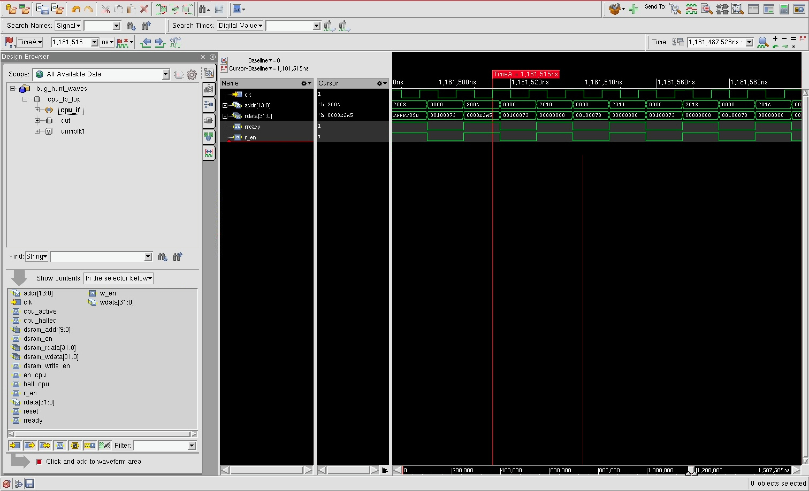

# Fall 2026 DV Onboarding Test Plan

<!--
Make two copies of this template:
  1. testplan_initial.md, submitted before implementing tests.
  2. testplan_final.md, updated after implementation and coverage closure.

Keep the initial copy unchanged after review. HTML comments are editing
instructions and disappear from rendered Markdown.
-->
## Document information

| Field | Value |
| --- | --- |
| Verification engineer | Anisha Dantam, anishadantam_35408, adantam6 |
| Plan revision | FINAL |
| Date | 2026-10-05 |

### Revision history

| Revision | Date | Changes |
| --- | --- | --- |
| Initial | 2026-09-26 | Initial planned tests |
| Final | 2026-10-05 | Added five directed tests implemented after the initial draft: 1.17 SRL_upperBitsIgnored, 1.18 BEQ_backwardLoop, 1.19 high_register_access, 1.20 BEQ_farForward, and 1.21 value_extremes. Completed the constrained-random program testing loop, replacing the outline with the implemented cycles and actual parameters. Documented the implemented random external-port traffic phase. Replaced the planned unmapped_never assertion, which was never implemented, with the three assertions written: single_cycle_halt, addrStable_duringRead, and en_cpu_single_cycle. Documented three Variant 0 bugs: store address wrong on carry out of bit 7, BEQ using the pre-load value after LW, and adjacent SW instructions holding dsram_write_en high.|

## 1. Functional tests

<!--
Plan tests for the CPU functionality supported by this onboarding. Organize
related behavior together. Include both individual instruction behavior and
multi-instruction sequences where ordering or dependencies matter.

Add as many rows and detailed test records as needed. Do not put every CPU
operation into one large program: each failure should identify a reasonably
small area to debug.
-->

### Functional-test summary

| Test ID | Test name | Functionality being tested | Expected result | Status |
| --- | --- | --- | --- | --- |
| 1.1 | `basic_ADD` | ADD register with register | rd = rs1 + rs2 | Implemented |
| 1.2 | `ADDI_pos` | ADDI with a positive immediate | rd = rs1 + imm | Implemented |
| 1.3 | `ADDI_neg` | ADDI with a negative immediate (sign extension) | rd = rs1 + imm (imm is sign extended) | Implemented |
| 1.4 | `SUB_rs1NEG` | SUB produces a negative (two's complement) result | rd = rs1 - rs2, where rd wraps to a negative | Implemented |
| 1.5 | `SUB_zero` | SUB produces a zero result | rd = rs1 - rs2, where rs1 == rs2 | Implemented |
| 1.6 | `SLL_amounts` | SLL across certain shift amount values (0,3,31) | rd = rs1 << rs2[4:0] with no wrap around past bit 31 | Implemented |
| 1.7 | `SRL_negOp` | SRL on a negative operand | rd = rs1 >> rs2[4:0], logical (zero padded) with no sign extension | Implemented |
| 1.8 | `LOADandSTORE` | SW then LW at the same address | loaded value = stored value | Implemented |
| 1.9 | `memory_bounds` | SW/LW at data memory word 0 and the highest valid word 1023 | Both word 0 and word 1023 read back correctly | Implemented |
| 1.10 | `BEQ_taken` | BEQ is taken when rs1 == 0 --> compared against x0 | Branch redirects program counter to branch target, the skipped instruction does not execute | Implemented |
| 1.11 | `BEQ_notTaken` | BEQ is not taken when rs1 is nonzero | program counter falls through to next sequential instruction | Implemented |
| 1.12 | `BEQ_regsEq` | BEQ compares two equal, non-zero registers (rs1 == rs2) and neither is x0 | Branch is taken based on rs1 == rs2 and is independent of x0 | Implemented |
| 1.13 | `x0_fixed` | Any instruction attempting to write x0 | x0 reads back as 0 in the cpu architecture and through the external register file window | Implemented |
| 1.14 | `instr_dependent` | A series of instructions where each result affects the outcome of the next (addi, add, sub series) | Each instruction is based off of the result of the prior one | Implemented |
| 1.15 | `branch_dependent` | A taken branch immediately followed by an instruction that depends on a register set earlier in the program | The instruction after the branch executes correctly and is not based on any instruction that was skipped | Implemented |
| 1.16 | `EBREAK_haltsOnce` | EBREAK halts execution | `cpu_halted_o pulses exactly once for exactly one cycle and no further instructions execute afterword | Implemented |
| 1.17 | `SRL_upperBitsIgnored` | SRL shift amounts of 32 and 33, which exceed the 5-bit field | Shift amount wraps mod 32, no restriction to 0/31 and no use of the full 32-but rs2 value | Implemented |
| 1.18 | `BEQ_backwardLoop` | A backward BEQ (negative immediate) forming a loop, landing beyond the end of the written program | Loop runs the correct number of iterations, the CPU halts cleanly | Implemented |
| 1.19 | `high_register_access` | ADD/SUB/ADDI on high-numbered registers x28-x31 | REgister file correctly reads/writes the top of its 32 register entry range, not just x1-x7 | Implemented |
| 1.20 | `BEQ_farForward` | BEQ with the maximum positive immediate (4092), reaching the last ISRAM word | Branch reaches word 1023 without truncation or wraparound; CPU halts there | Implemented |
| 1.21 | `value_extremes` | ADD/SUB overflow and underflow at the 2's complement boundary, SRL on a value with a signed bit, ADDI immediate extremes | All wraparound and shift results match 2's complement arithmetic; -2048 and 2047 both encode/decode correctly | Implemented |

### Functional-test details

<!-- Duplicate this complete record for every functional test. -->

### 1.1 — `basic_ADD`

**Functionality:** Checks whether the ADD instruction reads the source registers and writes to a third register.

**Initial state:**

- Registers: x1 = 22, x2 = 6 (there are setup prior using ADDIs in the same program)
- Data memory: unused
- Other setup: run_directed("basic_ADD", prog) using default max_cycles (2000). Standard program reset before program load. Readback: register file window, x1, x2, and x3.

**Program:**

<!-- Use the same representation that will be placed in run_member_directed_tests(). -->

```systemverilog
prog = '{
  asm_instr(.op(OP_ADDI), .rd(5'd1), .rs1(5'd0), .imm(22)),
  asm_instr(.op(OP_ADDI), .rd(5'd2), .rs1(5'd0), .imm(6)),
  asm_instr(.op(OP_ADD), .rd(5'd3), .rs1(5'd1), .rs2(5'd2))
  EBREAK_WORD
};
```

**Expected result:**

| Register or memory word | Expected value | Calculation or explanation |
| --- | --- | --- |
| `x1` | `32'h00000016` | `ADDI setup` |
| `x2` | `32'h00000006` | `ADDI setup` |
| `x3` | `32'h0000001c` | `22 + 6 = 28 --> 1c in hex & 32-bit sign extension`  |

**Pass criteria:** x3 should match with the expected value of 32'h0000001c. This should also confirm whether x1 and x2 match with their respective values to isolate whether there is a failure in the ADDI or ADD setup.

**Final result:** Passed

### 1.2 — `ADDI_pos`

**Functionality:** Checks that ADDI correctly adds a positive sign-extended immediate to rs1 and writes the result to the destination register.

**Initial state:**

- Registers: all are set to 0
- Data memory: unused
- Other setup: run_directed("ADDI_pos", prog) using default max_cycles (2000). Standard reset before program load. Readback: register-file window, x1.

**Program:**

<!-- Use the same representation that will be placed in run_member_directed_tests(). -->

```systemverilog
prog = '{
  asm_instr(.op(OP_ADDI), .rd(5'd1), .rs1(5'd0), .imm(13)),
  EBREAK_WORD
};
```

**Expected result:** 

| Register or memory word | Expected value | Calculation or explanation |
| --- | --- | --- |
| `x1` | `32'h0000000D` | `0 + 13 = 13 --> D in hex & 32 bit sign-extension` |

**Pass criteria:** x1 matches the expected value. No other register differs from its reset value of 0.

**Final result:** Passed

### 1.3 — `ADDI_neg`

**Functionality:** Checks that ADDI correctly sign-extends a negative 12-bit immediate before adding it to rs1, producing the expected two's complement result.

**Initial state:**

- Registers: all are set to 0
- Data memory: unused
- Other setup: run_directed("ADDI_neg", prog) using default max_cycles (2000). Standard reset before program load. Readback: register-file window, x1.

**Program:**

<!-- Use the same representation that will be placed in run_member_directed_tests(). -->

```systemverilog
prog = '{
  asm_instr(.op(OP_ADDI), .rd(5'd1), .rs1(5'd0), .imm(-37)),
  EBREAK_WORD
};
```

**Expected result:**

| Register or memory word | Expected value | Calculation or explanation |
| --- | --- | --- |
| `x1` | `32'hFFFFFFDB` | `binary --> 32'b00100101, hex (positive) --> 32'h00000025, inversion & two's complement --> 32'hFFFFFFDB` |

**Pass criteria:** x1 matches the expected value. A result equal to the zero-extended immediate (0x00000FDB) would indicate a sign-extension bug. No other register differs from its reset value of 0.

**Final result:** Passed

### 1.4 — `SUB_rs1NEG`

**Functionality:** Checks whether the SUB instruction produces a wrapped two's complement negative result when rs1 < rs2. This is being checked because the result
is a distinct value compared to when a positive subtraction (rs1 > rs2) is conducted.

**Initial state:**

- Registers: x1 = 5, x2 = 8 
- Data memory: unused
- Other setup: run_directed("SUB_rs1NEG", prog) using default max_cycles (2000). Standard reset before program load. Readback: register-file window, x1, x2, x3.

**Program:**

<!-- Use the same representation that will be placed in run_member_directed_tests(). -->

```systemverilog
prog = '{
  asm_instr(.op(OP_ADDI), .rd(5'd1), .rs1(5'd0), .imm(5)),
  asm_instr(.op(OP_ADDI), .rd(5'd2), .rs1(5'd0), .imm(8)),
  asm_instr(.op(OP_SUB), .rd(5'd3), .rs1(5'd1), .rs2(5'd2))
  EBREAK_WORD
};
```

**Expected result:**

| Register or memory word | Expected value | Calculation or explanation |
| --- | --- | --- |
| `x1` | `32'h00000005` | `ADDI setup` |
| `x2` | `32'h00000008` | `ADDI setup` |
| `x3` | `32'hFFFFFFFD` | `5 - 8 = -3 --> two's complement` |

**Pass criteria:** x1, x2, and x3 all match the expected values. No other register differs from its reset value of 0.

**Final result:** Passed

### 1.5 — `SUB_zero`

**Functionality:** Checks whether the SUB instruction produces zero when rs1 == rs2, which is the boundary between positive and negative results.

**Initial state:**

- Registers: x1 = 7, x2 = 7
- Data memory: unused
- Other setup: run_directed("SUB_zero", prog) using default max_cycles(2000). Standard reset before program load. Readback: register-file window, x1, x2, x3.

**Program:**

<!-- Use the same representation that will be placed in run_member_directed_tests(). -->

```systemverilog
prog = '{
  asm_instr(.op(OP_ADDI), .rd(5'd1), .rs1(5'd0), .imm(7)),
  asm_instr(.op(OP_ADDI), .rd(5'd2), .rs1(5'd0), .imm(7)), 
  asm_instr(.op(OP_SUB), .rd(5'd3), .rs1(5'd1), .rs2(5'd2)),
  EBREAK_WORD
};
```

**Expected result:**

| Register or memory word | Expected value | Calculation or explanation |
| --- | --- | --- |
| `x1` | `32'h00000007` | `ADDI setup` |
| `x2` | `32'h00000007` | `ADDI setup ` |
| `x3` | `32'h00000000` | `7 - 7 = 0` |

**Pass criteria:** x1, x2, and x3 all match expected values. No other registers differ from its reset value of 0.

**Final result:** Passed

### 1.6 — `SLL_amounts`

**Functionality:** Checks the SLL instruction across shift amounts 0, 3, 31, 32, and 33, confirming the shift amount is taken only from the low 5 bits of rs2 and not the the full 32-bit register. 32 and 33 specifically check that the amount wraps mod 32 (0 and 1 respectively).

**Initial state:**

- Registers: x1 = 2 (number being shifted), x2 = 0, x3 = 3, x4 = 31, x8 = 32, x9 = 33 (shift amounts)
- Data memory: unused
- Other setup: run_directed("SLL_amounts", prog) using default max_cycles (2000). Standard reset before program load.Readback: register-file window, x1-x11

**Program:**

<!-- Use the same representation that will be placed in run_member_directed_tests(). -->

```systemverilog
prog = '{
  asm_instr(.op(OP_ADDI), .rd(5'd1), .rs1(5'd0), .imm(2)),
  asm_instr(.op(OP_ADDI), .rd(5'd2), .rs1(5'd0), .imm(0)), 
  asm_instr(.op(OP_SLL), .rd(5'd5), .rs1(5'd1), .rs2(5'd2)), 
  
  asm_instr(.op(OP_ADDI), .rd(5'd3), .rs1(5'd0), .imm(3)),
  asm_instr(.op(OP_SLL), .rd(5'd6), .rs1(5'd1), .rs2(5'd3)),

  asm_instr(.op(OP_ADDI), .rd(5'd4), .rs1(5'd0), .imm(31)), 
  asm_instr(.op(OP_SLL), .rd(5'd7), .rs1(5'd1), .rs2(5'd4)),

  //shift amounts 32 and 33, exceeding the 5-bit field
  asm_instr(.op(OP_ADDI), .rd(5'd8), .rs1(5'd0), .imm(32)), 
  asm_instr(.op(OP_SLL), .rd(5'd10), .rs1(5'd1), .rs2(5'd8)), 
  asm_instr(.op(OP_ADDI), .rd(5'd9), .rs1(5'd0), .imm(33)), 
  asm_instr(.op(OP_SLL), .rd(5'd11), .rs1(5'd1), .rs2(5'd9)),
  EBREAK_WORD
};
```

**Expected result:**

| Register or memory word | Expected value | Calculation or explanation |
| --- | --- | --- |
| `x1` | `32'h00000002` | `ADDI setup` |
| `x2` | `32'h00000000` | `ADDI setup` |
| `x3` | `32'h00000003` | `ADDI setup` |
| `x4` | `32'h0000001f` | `ADDI setup (31)` |
| `x5` | `32'h00000002` | `2 << 0 = 2 (no shift)` |
| `x6` | `32'h00000010` | `2 << 3 = 16` |
| `x7` | `32'h00000000` | `2 <<31 --> bit 1 of the value 2 (0) shifts to bit position 32, which falls outside the 32-bit register, so it is shifted out and the result is 0` |
| `x8` | `32'h00000020` | `ADDI setup (32)` |
| `x9` | `32'h00000021` | `ADDI setup (33)` |
| `x10` | `32'h00000002` | `2 << (32 & 5'd1F = 0) = 2 --> shift amount 32 wraps to 0` |
| `x11` | `32'h00000004` | `2 << (33 & 5'h1F = 1) = 4 --> shift amount 33 wraps to 1` |

**Pass criteria:** x5, x6, x7, x10, and x11 all match expected values. x10 differing from x5 or x7 would indicate the amount is not being masked to 5 bits. No other registers differ from its reset value of 0.

**Final result:** Passed

### 1.7 — `SRL_negOp`

**Functionality:** Checks whether the SRL instruction is a logical right shift (pads zeros), not arithmetic. This tests specifically on a negative number, because a sign-extending SRL bug will be visible here.

**Initial state:**

- Registers: x1 = -1 (0xFFFFFFFF), x2 = 1 (shift amount)
- Data memory: unused
- Other setup: run_directed("SRL_negOP", prog) using default max_cycles (2000). Standard reset before program load. Readback: register-file window, x1, x2, x3

**Program:**

<!-- Use the same representation that will be placed in run_member_directed_tests(). -->

```systemverilog
prog = '{
  asm_instr(.op(OP_ADDI), .rd(5'd1), .rs1(5'd0), .imm(-1)),
  asm_instr(.op(OP_ADDI), .rd(5'd2), .rs1(5'd0), .imm(1)),
  asm_instr(.op(OP_SRL), .rd(5'd3), .rs1(5'd1), .rs2(5'd2)),
  EBREAK_WORD
};
```

**Expected result:**

| Register or memory word | Expected value | Calculation or explanation |
| --- | --- | --- |
| `x1` | `32'hFFFFFFFF` | `ADDI setup` |
| `x2` | `32'h00000001` | `ADDI setup` |
| `x3` | `32'h7FFFFFFF` |`0xFFFFFFFF >> 1 --> logical (top bit is filled with 0)` |

**Pass criteria:** x3 has bit 31 clear. If it instead reads 0xFFFFFFFF, SRL is sign-extending incorrectly. x1 and x2 also match their setup values. No other registers differs from its reset value of 0.

**Final result:** Passed

### 1.8 — `LOADandSTORE`

**Functionality:** Checks that a stored word can be read back correctly, confirming accurate memory location calculations and SRAM-timing for both load and store instructions.

**Initial state:**

- Registers: x1 = 40 (base address), x2 = 42 (value to be stored)
- Data memory: uninitialized
- Other setup: run_directed("LOADandSTORE", prog) using default max_cycles(2000). Standard reset before program load. Timeout allows extra margin beyond the 4-instruction program count to account for the multi-cycle SRAM read/write delay on LW and SW. Readback: register file window (x3) and data memory window (word 10). The memory word is checked independently of the register which is loaded back, as a bug could interfere with the load while the store itself was correct, or vice versa.

**Program:**

<!-- Use the same representation that will be placed in run_member_directed_tests(). -->

```systemverilog
prog = '{
  asm_instr(.op(OP_ADDI), .rd(5'd1), .rs1(5'd0), .imm(40)),
  asm_instr(.op(OP_ADDI), .rd(5'd2), .rs1(5'd0), .imm(42)),
  asm_instr(.op(OP_SW), .rs1(5'd1), .rs2(5'd2), .imm(0)),
  asm_instr(.op(OP_LW), .rd(5'd3), .rs1(5'd1), .imm(0)),
  EBREAK_WORD
};
```

**Expected result:**

| Register or memory word | Expected value | Calculation or explanation |
| --- | --- | --- |
| `x3` | `32'h0000002A` | `value loaded back equals value stored (42)` |
| `dmem[10]` | `32'h0000002A` | `byte address 40/4 = word 10` |

**Pass criteria:**  Both the register readback (x3) and the data memory readback (dmem[10]) match the stored value. If both hold the same value, this confirms that both the LW and SW logic are correct and not just one of them.

**Final result:** Passed

### 1.9 — `memory_bounds`

**Functionality:** Checks address computation and that the 10-bit conversion from a word to an index are correct at the ends of the data SRAM address range. If the computation was off by one, the addresses may accidentally point the same memory location of word 0 or a wrap past the top of the array might occur. Byte address 4092 (word 1023) cannot fit directly in a 12-bit signed immediate, so it is built using the SLL instruction.

**Initial state:**

- Registers: all are set to 0
- Data memory: unused
- Other setup:  run_directed("memory_bounds", prog) using default max_cycles (2000). Standard reset before program load. Timeout allows extra margin beyond the 11-intstruction count for two SW and two LW SRAM accesses. Readback: register file window (x7 and x8) and data memory window (word 0 and word 1023).

**Program:**

<!-- Use the same representation that will be placed in run_member_directed_tests(). -->

```systemverilog
prog = '{
  asm_instr(.op(OP_ADDI), .rd(5'd1), .rs1(5'd1), .imm(0)), // x1 --> base address for word 0
  asm_instr(.op(OP_ADDI), .rd(5'd3), .rs1(5'd0), .imm(17)), // value for word 0
  asm_instr(.op(OP_SW), .rs1(5'd1), .rs2(5'd3), .imm(0)),

  asm_instr(.op(OP_ADDI), .rd(5'd4), .rs1(5'd0), .imm(2)), // shift amount = 2 
  asm_instr(.op(OP_ADDI), .rd(5'd5), .rs1(5'd0), .imm(1023)), // word 1023
  asm_instr(.op(OP_SLL), .rd(5'd2), .rs1(5'd5), .rs2(5'd4)), //x2 = 1023 << 2 = 4092
  asm_instr(.op(OP_ADDI), .rd(5'd6), .rs1(5'd0), .imm(99)), // value for word 0

  asm_instr(.op(OP_SW), .rs1(5'd2), .rs2(5'd6), .imm(0)),
  asm_instr(.op(OP_LW), .rd(5'd7), .rs1(5'd1), .imm(0)), // reaed back word 0 to x7
  asm_instr(.op(OP_LW), .rd(5'd8), .rs1(5'd2), .imm(0)), // read back word 1023 to x8
  EBREAK_WORD
};
```

**Expected result:**

| Register or memory word | Expected value | Calculation or explanation |
| --- | --- | --- |
| `x7` | `32'h00000011` | `word 0 readback, unaffected by storing word 1023` |
| `x8` | `32'h00000063` | `word 1023 readback` |
| `dmem[0]` | `32'h00000011` | `confirms that there is no wrap around affecting word 0` |
| `dmem[1023]` | `32'h00000063` | `confirms that the top of the array is accessible` |

**Pass criteria:** All expected values for x7, x8, dmem[0], dmem[1023] match. The two register readbacks (x7 and x8) should agree with the two memory readbacks (dmem[0] and dmem[1023]). If this fails, there is an issue with either the load or store paths of the SRAM interface.

**Final result:** Passed

### 1.10 — `BEQ_taken`

**Functionality:** Checks whether the BEQ instruction redirect the program counter when rs1 is equal to 0 and that the instruction immediately following the branch does not execute.

**Initial state:**

- Registers: x1 = 0
- Data memory: unused
- Other setup: run_directed("BEQ_taken", prog) using default max_cycles (2000). Standard reset before program load. Program is 5 instructions. Readback: register file window, x1, x2, and x3.

**Program:**

<!-- Use the same representation that will be placed in run_member_directed_tests(). -->

```systemverilog
prog = '{
  asm_instr(.op(OP_ADDI), .rd(5'd1), .rs1(5'd0), .imm(0)),
  asm_instr(.op(OP_BEQ), .rs1(5'd1), .rs2(5'd0), .imm(8)), // skips the next instruction bc rs1 == 0
  asm_instr(.op(OP_ADDI), .rd(5'd2), .rs2(5'd0), .imm(45)), // skipped instruction
  asm_instr(.op(OP_ADDI), .rd(5'd3), .rs1(5'd0), .imm(3)), // branch target
  EBREAK_WORD
};
```

**Expected result:**

| Register or memory word | Expected value | Calculation or explanation |
| --- | --- | --- |
| `x2` | `32'h00000000` | `never executed --> BEQ skips this instruction` |
| `x3` | `32'h00000003` | `branch target executed` |

**Pass criteria:** x2 stays at its reset value of 0 --> confirms that the skipped instruction is never execture rather than executing and coincidentally producing 0. x3 should match the target result. x1 remains unchanged from setup value. 

**Final result:** Passed

### 1.11 — `BEQ_notTaken`

**Functionality:** Checks whether the BEQ instruction falls through to the next sequential instruction when the condition is false (complement to test 1.10)

**Initial state:**

- Registers: x1 = 7 (cannot be 0)
- Data memory: unused
- Other setup: run_directed("BEQ_notTaken", prog) using default max_cycles (2000). Standard reset before program load. Program is 3 instructions. Readback: register file window, x1, and x2.

**Program:**

<!-- Use the same representation that will be placed in run_member_directed_tests(). -->

```systemverilog
prog = '{
  asm_instr(.op(OP_ADDI), .rd(5'd1), .rs1(5'd0), .imm(7)),
  asm_instr(.op(OP_BEQ), .rs1(5'd1), .rs2(5'd0), .imm(8)),
  asm_instr(.op(OP_ADDI), .rd(5'd2), .rs1(5'd0), .imm(45)),
  EBREAK_WORD
};
```

**Expected result:**

| Register or memory word | Expected value | Calculation or explanation |
| --- | --- | --- |
| `x2` | `32'h0000002D` | `the fall through instruction is executed` |

**Pass criteria:** x2 matches the expected value. If this test fails, x2 would have the value 0 instead (instruction is skipped). x1 remains unchanged from the setup value.

**Final result:** Passed

### 1.12 — `BEQ_regsEq`

**Functionality:** Checks that rs1 == rs2 for the BEQ instruction comparison and is not an implicity rs1 == 0 shortcut like test 1.11.  

**Initial state:**

- Registers: x1 = 4, x2 = 5 (x1 == x1 and both are non-zero)
- Data memory: unused
- Other setup: run_directed("BEQ_regsEq", prog) using default max_cycles (2000). Standard reset before program load. Program is 5 instructions. Readback: register file window x1, x2, x3, and x4.

**Program:**

<!-- Use the same representation that will be placed in run_member_directed_tests(). -->

```systemverilog
prog = '{
  asm_instr(.op(OP_ADDI), .rd(5'd1), .rs1(5'd0), .imm(4)),
  asm_instr(.op(OP_ADDI), .rd(5'd2), .rs1(5'd0), .imm(4)), 
  asm_instr(.op(OP_BEQ), .rs1(5'd1), .rs2(5'd2), .imm(8)),

  asm_instr(.op(OP_ADDI), .rd(5'd3), .rs1(5'd0), .imm(45)), // skipped instruction
  asm_instr(.op(OP_ADDI), .rd(5'd4), .rs1(5'd0), .imm(3)), // branch target
  EBREAK_WORD
};
```

**Expected result:**

| Register or memory word | Expected value | Calculation or explanation |
| --- | --- | --- |
| `x3` | `32'h00000000` | `instruction is skipped --> branch is taken because x1 == x2` |
| `x4` | `32'h00000003` | `branch target is reached` |

**Pass criteria:** x3 stays 0 because x1 == x2 causes the instruction to be skipped and is distinguished from when x1 == 0. x4 should match the target result. x1 and x2 remain unchanged from the setup values.

**Final result:** Passed


### 1.13 — `x0_fixed`

**Functionality:** Checks that the x0 register cannot be written to by any instruction and always reads the value 0 both from the CPU's datapath and from the external register file.

**Initial state:**

- Registers: all are set to 0
- Data memory: unused
- Other setup: run_directed("x0_fixed", prog) using default max_cycles (2000). Standard reset before program load. Program is 2 instructions. Readback: register file window and x0

**Program:**

<!-- Use the same representation that will be placed in run_member_directed_tests(). -->

```systemverilog
prog = '{
  asm_instr(.op(OP_ADDI), .rd(5'd0), .rs1(5'd0), .imm(55)), // this is an attempt to write the value 55 to x0
  EBREAK_WORD
};
```

**Expected result:**

| Register or memory word | Expected value | Calculation or explanation |
| --- | --- | --- |
| `x0` | `32'h00000000` | `write must be ignored and x0 must retain its value of 0` |


**Pass criteria:** x0 reads 0 via the external register file despite an attempt to write 55 to it. Any nonzero readback will result in failure of the test.

**Final result:** Passed

### 1.14 — `instr_dependent`

**Functionality:** Checks a series of instructions where each depends on whether the preceding instruction executes correctly. Because I did not make the CPU pipelined, this confirms that the writeback of one instruction is fully complete before the next instruction's register is read.

**Initial state:**

- Registers: all set to 0
- Data memory: unused
- Other setup: run_directed("instr_dependent", prog) using default max_cycles (2000). Standard reset before program load. Program is 5 instructions. Readback: register file window and x1. It is important to note here that only the final value after the series of instructions is complete can be examined in the register file window.

**Program:**

<!-- Use the same representation that will be placed in run_member_directed_tests(). -->

```systemverilog
prog = '{
  asm_instr(.op(OP_ADDI), .rd(5'd1), .rs1(5'd0), .imm(9)),
  asm_instr(.op(OP_ADDI), .rd(5'd2), .rs1(5'd0), .imm(4)),
  asm_instr(.op(OP_ADD), .rd(5'd1), .rs1(5'd1), .rs2(5'd2)), // x1 = x1 + x2 = 9 + 4 = 13
  asm_instr(.op(OP_SUB), .rd(5'd1), .rs1(5'd1), .rs2(5'd1)), // x1 = x1 - x1 = 13 - 13 = 0 
  asm_instr(.op(OP_ADDI), .rd(5'd1), .rs1(5'd1), .imm(11)), // x1 = 0 + 11 = 11
  EBREAK_WORD
};
```

**Expected result:**

| Register or memory word | Expected value | Calculation or explanation |
| --- | --- | --- |
| `x1` | `32'h0000000B` | `9 --> 13 --> 0 --> 11 because each step depends on the result prior` |

**Pass criteria:** The final x1 value matches, which proves that every successive tep used the correctly updated value of x1. x2 remains as its setup value. No other register differs from its reset value of 0.

**Final result:** Passed

### 1.15 — `branch_dependent`

**Functionality:** Checks that immediately after a branch is taken, the next executed instruction (the branch target) reads correctly and that no side effects happens due to the skipped instruction.

**Initial state:**

- Registers: x1 = 0, x2 = 5
- Data memory: unused
- Other setup: run_directed("branch_dependent", prog) using default max_cycles (2000). Standard reset before program load. Program is 5 instructions. Readback: register file window, x1, x2, and x3.

**Program:**

<!-- Use the same representation that will be placed in run_member_directed_tests(). -->

```systemverilog
prog = '{
  asm_instr(.op(OP_ADDI), .rd(5'd1), .rs1(5'd0), .imm(0)),
  asm_instr(.op(OP_ADDI), .rd(5'd2), .rs1(5'd0), .imm(5)), 
  asm_instr(.op(OP_BEQ), .rs1(5'd1), .rs2(5'd0), .imm(8)), 
  
  asm_instr(.op(OP_ADD), .rd(5'd2), .rs1(5'd2), .rs2(5'd2)), // skipped instruction
  asm_instr(.op(OP_ADDI), .rd(5'd3), .rs1(5'd2), .imm(1)), // depends on x2
  EBREAK_WORD
};
```

**Expected result:**

| Register or memory word | Expected value | Calculation or explanation |
| --- | --- | --- |
| `x2` | `32'h00000005` | `unmodified --> doubling instruction is skipped, shouldn't be 32'h0000000A` |
| `x3` | `32'h00000006` | `5 + 1 = 6 --> x2 is read correctly after the branch` |

**Pass criteria:** x2 and x3 both match the expected values. A bug that still executes the skipped instruction would result in x2 = 10 and x3 = 11. x1 remains unchanged from setup value.

**Final result:** Passed

### 1.16 — `EBREAK_haltsOnce`

**Functionality:** Checks that cpu_halted_o pulses exactly for one cycle when EBREAK halts, as this must be sampled every cycle.

**Initial state:**

- Registers: all are set to 0
- Data memory: unused
- Other setup: run_directed("EBREAK_haltsOnce", prog) using default max_cycles (2000). Standard reset before program load. Program is 2 instructions. Readback: register file window and x1. This also counts the rising edges of cpu_halted_o across the entire simulation window.

**Program:**

<!-- Use the same representation that will be placed in run_member_directed_tests(). -->

```systemverilog
prog = '{
  asm_instr(.op(OP_ADDI), .rd(5'd1), .rs1(5'd0), .imm(1)),
  EBREAK_WORD
};
run_directed("EBREAK_haltsOnce", prog);

if (halted_cycles != 1) begin 
	assertion_fail($sformatf("cpu_halted was high for %0d cycles, expected only 1", halted_cycles)); 
end
```

**Expected result:**

| Register or memory word | Expected value | Calculation or explanation |
| --- | --- | --- |
| `cpu_halted_o pulse count` | `1` | `one rising edge observed across whole simulation` |
| `x1` | `32'h00000001` | `Confirms the instruction before EBREAK still executed correctly` |

**Pass criteria:** cpu_halted_o is high on only one egde across the entire run. It should not be zero and not more than one. x1 matches its expected value and should confirm that the instruction before ebreak still executes correctly.

**Final result:** Passed

## TESTS ADDED DURING COVERAGE CLOSURE

### 1.17 — `SRL_upperBitsIgnored`

**Functionality:** Checks SRL shift amounts of 32 and 33, which exceed the shift field, confirming the amount wraps mod 32 (0 and 1 respectively) rather than restricting to 0/31 or using the full 32-bit rs2 value. This complements test 1.6, which checks the same property on SLL.

**Initial state:**

- Registers: x1 = -1 (0xFFFFFFFF), x2 = 32, x3 = 33
- Data memory: unused
- Other setup: run_directed("SRL_upperBitsIgnored", prog) with default max_cycles (2000). Standard reset before program load. Readback: register-file window, x1-x5

**Program:**

<!-- Use the same representation that will be placed in run_member_directed_tests(). -->

```systemverilog
prog = '{
  asm_instr(.op(OP_ADDI), .rd(5'd1), .rs1(5'd0), .imm(-1)), 
	asm_instr(.op(OP_ADDI), .rd(5'd2), .rs1(5'd0), .imm(32)),
	asm_instr(.op(OP_ADDI), .rd(5'd3), .rs1(5'd0), .imm(33)),
	asm_instr(.op(OP_SRL), .rd(5'd4), .rs1(5'd1), .rs2(5'd2)),
	asm_instr(.op(OP_SRL), .rd(5'd5), .rs1(5'd1), .rs2(5'd3)),
	EBREAK_WORD	
};
```

**Expected result:**

| Register or memory word | Expected value | Calculation or explanation |
| --- | --- | --- |
| `x1` | `32'hFFFFFFFF` | `ADDI setup` |
| `x2` | `32'h00000020` | `ADDI setup (32)` |
| `x3` | `32'h00000021` | `ADDI setup (33)` |
| `x4` | `32'hFFFFFFFF` | `0xFFFFFFFF >> (32 & 5'h1F = 0) --> no shift` |
| `x5` | `32'h7FFFFFFF` | `0xFFFFFFFF >> (33 & 5'h1F = 1) --> 1 bit logical shift` |

**Pass criteria:** x4 equals x1 unshifted (confirms amount 32 wraps to 0). x5 equals a 1 bit logical right shift of x1. A bug that uses the full value wouldl produce a different result

**Final result:** Passed

### 1.18 — `BEQ_backwardLoop`

**Functionality:** Checks a backward BEQ (negative immediate) forming a loop that increments x1 until it equals x2, confirming negative branch offsets. work and the loop terminates. Also confirms BEQ never writes a destination register, and that a branch landing beyond this test's own program correctly reaches the EBREAK written by init_memories() rather than executing undefined instruction words.

**Initial state:**

- Registers: x1 = 0, x2 = 3
- Data memory: unused
- Other setup: run_directed("BEQ_backwardLoop", prog) with default max_cycles (2000). Standard reset before program load. Readback: register-file window, x1, x2, and x3.

**Program:**

<!-- Use the same representation that will be placed in run_member_directed_tests(). -->

```systemverilog
prog = '{
  asm_instr(.op(OP_ADDI), .rd(5'd1), .rs1(5'd0), .imm(0)),
	asm_instr(.op(OP_ADDI), .rd(5'd2), .rs1(5'd0), .imm(3)),
	asm_instr(.op(OP_ADDI), .rd(5'd1), .rs1(5'd1), .imm(1)),
	asm_instr(.op(OP_BEQ), .rs1(5'd1), .rs2(5'd2), .imm(8)),
	asm_instr(.op(OP_BEQ), .rs1(5'd0), .rs2(5'd0), .imm(-8)), 
	asm_instr(.op(OP_BEQ), .rd(5'd3), .rs1(5'd0), .imm(99)),
	EBREAK_WORD
};
```

**Expected result:**

| Register or memory word | Expected value | Calculation or explanation |
| --- | --- | --- |
| `x1` | `32'h00000003` | `Loop increments x1 three times before x1 == x2 exits the loop` |
| `x2` | `32'h00000003` | `unmodified loop bound` |
| `x3` | `32'h00000000` | `BEQ never writes to rd` |

**Pass criteria:** x1 and x2 both read 3. x3 stays 0, confirming BEQ ignored the rd field. The run completes (lasta_run_completed = 1) rather than timing out, confirming the final unconditional branch correctly landed on an EBREAK word in the filler region rather than running into undefined instruction content.

**Final result:** Passed

### 1.19 — `high_register_access`

**Functionality:** Checks that the register file correctly reads and writes high numbered registers (x28-x31), not just the low registers (x1-x7) that c_reg_bias weights toward in random testing.

**Initial state:**

- Registers: all are set to 0
- Data memory: unused
- Other setup: run_directed("high_register_access", prog) with default max_cycles (2000). Standard reset before program load. Readback: register-file window, x28-x31

**Program:**

<!-- Use the same representation that will be placed in run_member_directed_tests(). -->

```systemverilog
prog = '{
  asm_instr(.op(OP_ADDI), .rd(5'd28), .rs1(5'd0), .imm(15)),
	asm_instr(.op(OP_ADDI), .rd(5'd29), .rs1(5'd28), .imm(10)),
	asm_instr(.op(OP_ADD), .rd(5'd30), .rs1(5'd28), .rs2(5'd29)),
	asm_instr(.op(OP_SUB), .rd(5'd31), .rs1(5'd30), .rs2(5'd28)),
	EBREAK_WORD
};
```

**Expected result:**

| Register or memory word | Expected value | Calculation or explanation |
| --- | --- | --- |
| `x28` | `32'h0000000F` | `15` |
| `x29` | `32'h00000019` | `15 + 10 = 25` |
| `x30` | `32'h00000028` | `15 + 25 = 40` |
| `x31` | `32'h00000019` | `40 - 15 = 25` |

**Pass criteria:** x28, x29, x30, and x31 match their expected values. A register file that did not decode bit 4 of the 5-bit address correctly would show up as a mismatch despite earlier lower register tests passing.

**Final result:** Passed

### 1.20 — `BEQ_farForward`

**Functionality:** Checks that a branch immediate at its maximum positive, word-aligned value (4092) correctly reaches the very last ISRAM word (word 1023) without wraparound or truncation, and that landing there still correctly reads back EBREAK.

**Initial state:**

- Registers: all are set to 0
- Data memory: unused
- Other setup: run_directed("BEQ_farForward", prog) with default mac_cycles (2000). Standard reset before program load. Readback: register-file window

**Program:**

<!-- Use the same representation that will be placed in run_member_directed_tests(). -->

```systemverilog
prog = '{
  asm_instr(.op(OP_BEQ), .rs1(5'd0), .rs2(5'd0), .imm(4092)),
	EBREAK_WORD
};
```

**Expected result:**

| Register or memory word | Expected value | Calculation or explanation |
| --- | --- | --- |
| `All registers` | `32'h00000000` | `The BEQ is the only instruction executed and never writes rd` |

**Pass criteria:** The run completes (last_run_completed = 1) rather than timing out, and every register reads 0. A branch target truncation would either never reach a halt or land on a word that is not an EBREAK.

**Final result:** Passed

### 1.21 — `value_extremes`

**Functionality:** Cheks ALU arithmetic and shifter corner cases. 1 << 31 produces the most negative 32-bit value, ADD/SUB wraparound at both 2's complement boundaries (overflow and underflow), SRL correctlly performs an unsigned logical shift on a value whose only set bit is the sign bit, and the ADDI immediate field's full range works.

**Initial state:**

- Registers: all are set to 0
- Data memory: unused
- Other setup: run_directed("value_extremes", prog) with default max_cycles (2000). Standard reset before program load. Readback: register file window, x1-x11.

**Program:**

<!-- Use the same representation that will be placed in run_member_directed_tests(). -->

```systemverilog
prog = '{
  asm_instr(.op(OP_ADDI), .rd(5'd1), .rs1(5'd0), .imm(1)), 
	asm_instr(.op(OP_ADDI), .rd(5'd2), .rs1(5'd0), .imm(31)), 
	asm_instr(.op(OP_SLL), .rd(5'd3), .rs1(5'd1), .rs2(5'd2)), 
	asm_instr(.op(OP_ADDI), .rd(5'd4), .rs1(5'd3), .imm(-1)), 
	asm_instr(.op(OP_ADD), .rd(5'd5), .rs1(5'd4), .rs2(5'd4)), 
	asm_instr(.op(OP_ADD), .rd(5'd6), .rs1(5'd3), .rs2(5'd3)),
	asm_instr(.op(OP_SUB), .rd(5'd7), .rs1(5'd6), .rs2(5'd1)),
	asm_instr(.op(OP_SUB), .rd(5'd8), .rs1(5'd3), .rs2(5'd1)),
	asm_instr(.op(OP_SRL), .rd(5'd9), .rs1(5'd3), .rs2(5'd2)), 
	asm_instr(.op(OP_ADDI), .rd(5'd10), .rs1(5'd0), .imm(-2048)), 
	asm_instr(.op(OP_ADDI), .rd(5'd11), .rs1(5'd0), .imm(2047)),
	EBREAK_WORD
};
```

**Expected result:**

| Register or memory word | Expected value | Calculation or explanation |
| --- | --- | --- |
| `x1` | `32'h00000001` | `ADDI setup` |
| `x2` | `32'h0000001F` | `ADDI setup (31)` |
| `x3` | `32'h80000000` | `1 << 31` |
| `x4` | `32'h7FFFFFFF` | `	0x80000000 + (-1), wraps from most-negative to maximum integer` |
| `x5` | `32'hFFFFFFFE` | `max int + max int --> overflow wrap` |
| `x6` | `32'h00000000` | `most negative + most negative --> overflow wraps to 0` |
| `x7` | `32'hFFFFFFFF` | `0 - 1, underflow wraps to -1` |
| `x8` | `32'h7FFFFFFF` | `0x80000000 - 1, same result as x4 through SUB` |
| `x9` | `32'h00000001` | `0x80000000 >> 31, logical shift of the sign bit to bit 0` |
| `x10` | `32'hFFFFF800` | `-2048` |
| `x11` | `32'h000007FF` | `2047` |

**Pass criteria:** All eleven registers match. x4 and x8 should agree, cross-checking that ADD and SUB handle the same wraparound identically. x9 reading exactly 1. x10 and x11 confirm the ADDI immediate decoder does not truncate at the edges of its signed 12-bit range.

**Final result:** Passed


## 2. Constrained-random tests

### Instruction constraints

<!--
Explain the provided constraints, then record how the partial and open
constraints are completed. State what each constraint permits, excludes, or
biases and why the resulting programs remain useful and terminating.
-->

| Constraint | Provided, partial, or open | Behavior and purpose | Final implementation summary |
| --- | --- | --- | --- |
| `c_opcode` | Provided | Restricts generated operation to the supported set: OP_ADD, OP_ADDI, OP_SUB, OP_SLL, OP_SRL, OP_LW, OP_SW, and OP_BEQ. | No member change |
| `c_reg_bias` | Provided | Weighted distribution that biases rd, rs1, and rs2 toward x0 and a small working set (x1-x7), which increases both interaction with x0 and register dependency frequency compared to only random selection. | No member change |
| `c_imm_range` | Partial | Bounds imm to keep it within the 12-bit signed range of the I-type and S-type instruction immediate fields. | Added imm <= 2047, matching the lower bound that is already present. Also added (op == OP_SLL (or) op == OP_SRL) -> (imm >= 0 && imm <= 31) in case, but not necessary. |
| `c_mem_align` | Open | Constrains the LW/SW imm to a multiple of 4 (so that it aligns with a word) and to a range that keeps rs1 + imm inside the valid data SRAM address space, given that address registers are set up by earlier instructions. | if (op == OP_LW (or) op == OP_SW) { (reg_snapshot[rs1]+imm)%4==0; (reg_snapshot[rs1]+imm)>=0; (reg_snapshot[rs1]+imm)<=4092; } --> Constrains reg_snapshot[rs1] + imm (the actual runtime effective address, not just the immediate) to be a multiple of 4 and within [0, 4092], implied on op == OP_LW or op == OP_SW |
| `c_imm_unused` | Provided | Forces imm == 0 for the register-only operations (OP_ADD, OP_SUB, OP_SLL, and OP_SRL), which prevents the 'don't care' bits from being mistaken for an actual constraint violation. | No member change |
| `c_branch_target` | Partial | Currently enforces alignment with words and an offset that only allows forward branches (imm % 4 == 0, imm >= 4), but it still needs an upper bound tied to prog_len and idx so that a branch can never target past the end of the generated program | (op == OP_BEQ) -> { imm % 4 == 0; imm >= 4; (idk*4) + imm <= ((prog_len - 1)*4); } Every branch lands n a real instruction slot within the program (never past it and necer on itself or backward), so reachability is guaranteed without relying on EBREAK |
| `c_no_branch_at_end` | Provided | Prevents OP_BEQ from being an instruction generated in the final one or two program slots and keeps the order with the ebreak intact. | No member change |
| `c_branch_taken_bias` | Open | Sometimes forces rs1 == rs2 for OP_BEQ so that this occurs for a significant enough fraction of the time, as it is rare for randomly-generated register values to equal each other on their own. In other words, this bias of BEQ ensures that both the taken and not-taken outcomes occur often enough to close coverage | (op == OP_BEQ) -> { (rs1 == rs2) dist {1:=40, 0:=60}; } This constrains the register index equality, so the 40% branch reliably produces a taken outcome regardless of what value that current register holds. The 60% branch does biases toward not-taken.|

### External-port constraints

| Constraint | Provided, partial, or open | Behavior and purpose | Final implementation summary |
| --- | --- | --- | --- |
| `c_align` | Provided | Constrains external-port addresses to word alignment | No member change |
| `c_valid_window` | Partial | Bounds addr_i [13:12] to the three defined windows (instruction SRAM, data SRAM, and register file) for scenarios where 'valid access' is applicable, while still allowing the unmapped 2'b11 window to be generated for unmapped access testing. | Restricts addr[13:12] to the three defined widnodws and bounds addr[11:2] < REG_COUNT for the register window, so only its 32 real entries get address. The unmapped window (2'b11) is excluded entirely. = |
| `c_reg_read_only` | Provided | Prevents w_en_i from being generated alongside a register file window address because the window is read-only | No member change |
| `c_data_corners` | Open | Should bias generated write data towards corner values (such as 0x00000000, 0xFFFFFFFF, 0x80000000, 0x7FFFFFFF) instead of random data so that these values are tested more often. | Weighted dist on write data: ~10.5% each on 0x00000000, 0xFFFFFFFF, 0x7FFFFFFF, 0x80000000, ~5% on 0x00000001, remaining 53% spread uniformly across the rest of the 32 bit range.|

### Random-program test

| Item | Plan |
| --- | --- |
| Number of programs per seed | 20 (NUM_RANDOM_PROGRAMS) |
| Program-length range | 10-40 random instructions ($urandom_range(10,40) before the sequencer appends its own EBREAK) |
| Information logged for reproduction | Numeric SVSEED, iteration index, and complete generated program |

**Implementation outline:**

```systemverilog
// Write the intended loop and lifecycle using seqr.gen_program(...).
/*
for (int i = 0; i < NUM_RANDOM_PROGRAMS; i++) begin
		$display($stime, " TB: Starting Random Iteration %0d/%0d ", i + 1, NUM_RANDOM_PROGRAMS);
		sb.set_test($sformatf("random_prog_%0d", i));

    // reset and reinitialize
		drv.reset_task();
		init_memories();
		seqr.gen_program($urandom_range(10,40));

    // wait for the instruction writes, then run bounded by run_timeout (20000 cycles)
		seqr.wait_for_empty();
		repeat (2) @(cpu_if.cb);

		drv.run_program(2000);

		// register and data-memory readback for the scoreboard to check
    // or skip readback and reset after a timeout so a broken run does not also
    // generate misleading secondary mismatches
		if (drv.last_run_completed) begin
			readback(2, REG_COUNT); 
			readback(1, DSRAM_WORDS);
		end else begin
			$display( "TB: random program %0d timed out, skipping readback", i);
			drv.reset_task();
		end
end

External Port Random Traffic
--> Implemented as a separate phase after the random-program loop where the CPU is disabled
--> each of the 300 transactions is independently constrained and randomized by cpu_xbar_item
	sb.set_test("random_xbar_traffic"); 
	drv.reset_task();
	seqr.gen_xbar(NUM_RANDOM_XBAR); // NUM_RANDOM_XBAR = 300
	seqr.wait_for_empty();
	repeat (10) @(cpu_if.cb);
*/
```

## 3. Assertions

<!--
Plan at least two assertions in addition to the supplied example. Write the
timing rule in English first. In the final plan, include the exact SVA and
evidence from a temporary violation proving that the assertion can fire.
-->

### Assertion summary

| Assertion ID/name | Behavior checked | When it is sampled/disabled | Activating test |
| --- | --- | --- | --- |
| 4.1 / `single_cycle_halt` | cpu_halted_o should never be high for two consecutive cycles | sampled every posedge clk_i and is disabled during reset | test 1.16 (EBREAK_haltsOnce) and any random program that reaches EBREAK |
| 4.2 / `addrStable_duringRead` | While a read is pending (requested but not yet acknowledged by rready), addr must not change | Sampled every posedge clk_i and is disabled during reset | Any external read, mostly applies while xbar_read is polling for rready |
| 4.3 / `en_cpu_single_cycle` | en_cpu_i must be a single-cycle pulse. If sampled high on one edge, must be low on the next. | Sampled every posedge clk_i and is disabled during reset | start_cpu(), exercised by any test that runs a program |


### 4.1 — `single_cycle_halt`

**Timing requirement in words:** cpu_halted_o is defined as a single cycle pulse. The monitor's own event generation is edge-triggered and would only ever give rise to a cpu halt event regardless of the signal's actual duraction. This assertion will flag a cpu that is stuck on high at the interface level and it checks that cpu_halted_o is never sampled high on two consecutive rising clock edges.

```systemverilog
single_cycle_halt:
  assert property (@(posedge clk) disable iff (rst)
    (cpu_halted_o |=> !cpu_halted_o)
  else assertion_fail("cpu_halted_o remained high for more than one cycle");
```

**Evidence that it detects a violation:** 

A temporary test (`violation_test_single_cycle_halt`) waited for the first `cpu_halted` pulse, then held `cpu_if.cpu_halted` high for 3 clock cycles, so it was high on consecutive sampled edges. The assertion fired as soon as the second high sample was seen (refer to simulation-singlecycleVIOLATION.log): 

```
41125 Mon: cpu_halted_o asserted
xmsim: *E,ASRTST (./sym_links/cpu_tb_top.sv,582): (time 41135 NS) Assertion cpu_tb_top.single_cycle_halt has failed (2 cycles, starting 41125 NS)
41135 ASSERT: cpu_halted_o stayed high for more than one cycle
```
It fired a second time at 41145 NS (window starting 41135 NS) because the forced signal was still high.


### 4.2 — `addrStable_duringRead`

**Timing requirement in words:** A read holds addr_i and r_en_i until rready is observed. The address must stay fixed for the whole time a reading is pending.

```systemverilog
addrStable_duringRead:
  assert property (@(posedge clk) disable iff (rst)
    ($past(cpu_if.r_en) && cpu_if.r_en && !$past(cpu_if.rready)) |-> $stable(cpu_if.addr))
  else assertion_fail("addr changed while a read was still pending");
```

**Evidence that it detects a violation:** 

A temporary test (`violation_test_addr_stable`) started an external read of ISRAM word 0, waited until `r_en` was high, then forced `cpu_if.addr` to `14'h3FFC` for 2 cycles while `rready` had not yet been observed. The assertion fired on the cycle the address changed (refer to simulation-addrStableVIOLATION.log): 

```
xmsim: *E,ASRTST (./sym_links/cpu_tb_top.sv,610): (time 41045 NS) Assertion cpu_tb_top.addrStable_duringRead has failed
41045 ASSERT: addr changed while a read was still pending
```
The read to 0x0000 then timed out after 32 cycles.


### 4.3 — `en_cpu_single_cycle`

**Timing requirement in words:** When the cpu halts (is no longer active), cpu_enable drops back to 0, which samples en_cpu_i again, which should be low. In other words en_cpu_i must only be pulsed for one cycle.

```systemverilog
en_cpu_single_cycle:
  assert property (@(posedge clk) disable iff (rst)
    (cpu_if.en_cpu |=> !cpu_if.en_cpu)
  else assertion_fail("en_cpu_i was held for more than one cycle");
```

**Evidence that it detects a violation:** 

A temporary test (`violation_test_en_cpu_pulse`) held `cpu_if.en_cpu` high for 2 clock cycles instead of a single-cycle pusle. The assertion fired on the first edge where `en_cpu` was still high after the previous sample (refer to simulation-encpuVIOLATION.log): 

```
xmsim: *E,ASRTST (./sym_links/cpu_tb_top.sv,631): (time 95 NS) Assertion cpu_tb_top.en_cpu_single_cycle has failed (2 cycles, starting 85 NS)
95 ASSERT: en_cpu_i was held for more than one cycle
```

## 4. Encrypted CPU Bug Hunt (VARIANT 0)

### Random discovery #1

| Field                    | Evidence                      |
| ------------------------ | ----------------------------- |
| Discovery command        | `make bug_hunt SEED=random`   |
| Numeric `SVSEED`         |          -698716985           |
| Failing iteration        |        random_prog_7 (log banner "Starting Random Iteration 8/20")        |
| First failure message    |  671135 SB: [random_prog_7] store #1: got dmem[0x003] <- 0xfffffabc, expected dmem[0x043] <- 0xfffffabc  |
| Reproduction command     | `make bug_hunt SEED=-698716985` |
| Reproduces consistently? |              Yes                |

**Original failing program:**

```systemverilog
prog = '{
  32'h0x6688f8313  //[0] addi x6, x31, 1672
  32'h0x5f422083  //[1] lw x1, 1524(x4)
  32'h0x00720733  //[2] add x14, x4, x7
  32'h0x02b08a63  //[3] beq x1, x11, 52
  32'h60x00219033  //[4] sll x0, x3, x2
  32'h0x2e928793  //[5]maddi x15, x5, 745
  32'h0x00619eb3  //[6] sll x29, x3, x6
  32'h0x0001d3b3  //[7] srl x7, x3, x0
  32'h60x6812a823  //[8] sw x1, 1680(x5)
  32'h0x00075333  //[9] srl x6, x14, x0
  32'h0xabc10113  //[10] addi x2, x2, -1348
  32'h0x40510333  //[11] sub x6, x2, x5
  32'h0x00425333  //[12] srl x6, x4, x4
  32'h0xe1628193  //[13] addi x3, x5, -490
  32'h0x04000063  //[14] beq x0, x0, 64
  32'h0xc2010313  //[15] addi x6, x2, -992
  32'h0xb9e28193  //[16] addi x3, x5, -1122
  32'h0x40728133  //[17] sub x2, x5, x7
  32'h0x00139233  //[18] sll x4, x7, x1
  32'h0x62c12c83  //[19] lw x25, 1580(x2)
  32'h0xb7e18093  //[20] addi x1, x3, -1154
  32'h0x003013b3  //[21] sll x7, x0, x3
  32'h0x4e732c23  //[22] sw x7, 1272(x6)
  32'h0x230fa103  //[23] lw x2, 560(x31)
  32'h0x00738863  //[24] beq x7, x7, 16
  32'h0x00b7d233  //[25] srl x4, x15, x11
  32'h0x0079d2b3  //[26] srl x5, x19, x7
  32'h0x6b4ca083  //[27] lw x1, 1716(x25)
  32'h0x02630063  //[28] beq x6, x6, 32
  32'h0x122f0113  //[29] addi x2, x30, 290
  32'h0x00ab0cb3  //[30] add x25, x22, x10
  32'h0x2e21ab23  //[31] sw x2, 758(x3)
  32'h0x6b022e03  //[32] lw x28, 1712(x4)
  32'h0x70422e03  //[33] lw x28, 1796(x4)
  32'h0x2242a223  //[34] sw x4, 548(x5)
  32'h0x5ac32283  //[35] lw x5, 1452(x6)
  32'h0x76412623  //[36] sw x4, 1900(x2)
  32'h0x00100073  //[37] ebreak
  EBREAK_WORD
};
```

### Expected vs. actual

| Instruction / event | Expected | Actual | Cycle/time |
| ------------------- | -------- | ------ | ---------- |
|  [8] sw x1, 1680(x5) (store #0), x5 = 0    |  dmem[0x1a4] <- 0xb082a689  |  dmem[0x1a4] <- 0xb082a689  |  671045 ns  |
|  [31] sw x2, 758(x3) (store #1), x3 = -490, x2 = -1348  |  dmem[0x043] <- 0xfffffabc  |  dmem[0x003] <- 0xfffffabc  |  671135 ns  |
| [34] sw x4, 548(x5) (store #2), x5 = 0  |  dmem[0x089] <- 0x00000000  | dmem[0x089] <- 0x00000000   |  671195 ns   |
| [36] sw x4, 1900(x2) (store #3), x2 = -1348  |  dmem[0x08a] <- 0x00000000 | dmem[0x04a] <- 0x00000000  | 671235 ns  |


**First architectural divergence:**

<!-- State the first register, memory, or control-flow result that becomes incorrect. -->

The first incorrect result is the store at Seq[31], which is sw x2, 758(x3). With x3 = 0xFFFFFE16 (-490) and imm = 758, the effective byte address is 268 (0x10C), which is word 0x043. The CPU instead wrote word 0x003, exactly 0x40 words (0x100 bytes) lower. The write data (0xfffffabc) is correct, so only the address is wrong. The earlier store (0x1a4) and load (0x17d) matched.

### Minimization

**Minimized reproducer:**

```systemverilog
prog = '{
  asm_instr(.op(OP_ADDI), .rd(1), .rs1(0), .imm(12'h080)), // x1 = 0x80
  asm_instr(.op(OP_ADDI), .rd(2), .rs1(0), .imm(12'h111)), // x2 = 0x111
  asm_instr(.op(OP_SW), .rs1(1), .rs2(2), .imm(12'h080)), // 0x80 + 0x80 = 0x100 bytes --> word 0x040
  EBREAK_WORD
};
run_directed("SW_carryOutbit7", prog);
```

### Waveform evidence

<!--Include a screenshot showing the offending instruction and the first incorrect architectural result.--!>




##Conclusion

**Trigger:**

<!-- Smallest condition that causes the failure. --!>

A store word (sw) whose effective address (rs1 + sign-extended imm) produces a carry out of bit 7 of the low-byte addition. In random_prog_7, both stores with that carry ([31] and [36]) were wrong and both without it ([8] and [34]) were correct.

**Expected behavior:**

<!-- ISA-correct behavior. -->

sw writes dmem[(rs1 + imm) >> 2]. For the minimized reproducer, that is word 0x040.

**Observed behavior:**

<!-- What the encrypted CPU does instead. -->

The encrypted CPU drives the correct write data, but to a word address exactly 0x40 words (0x100 bytes) lower than the ISA-correct address (0x003 instead of 0x043).

**Behavioral characterization:**

<!-- One precise sentence. Do not speculate about hidden RTL. -->

When the effective address of a store has a carry out of bit 7, the encrypted CPU writes the correct data to a data-memory word address 0x40 words lower than the ISA-correct address.


### Random discovery #2

| Field                    | Evidence                      |
| ------------------------ | ----------------------------- |
| Discovery command        | `make bug_hunt SEED=random`   |
| Numeric `SVSEED`         |        -205329340             |
| Failing iteration        |  random_prog_14 (log banner: "Starting Random Iteration 15/20")      |
| First failure message    | 1181515 SB: [random_prog_14] read of register x3 returned 0x0000e2a5, expected 0x000007e4  |
| Reproduction command     | `make bug_hunt SEED=-205329340` |
| Reproduces consistently? |             Yes               |

**Original failing program:**

```systemverilog
prog = '{
  32'h006190b3, // [0] sll x1, x3, x6
  32'h00330133, // [1] add x2, x6, x3
  32'h5203a183, // [2] lw x3, 1312(x7)
  32'h12032083, // [3] lw x1, 288(x6)
  32'h03a08463, // [4] beq x1, x26, 40
  32'h4202a303, // [5] lw x6, 1056(x5)
  32'h5a812583, // [6] lw x11, 1448(x2)
  32'h0a43a103, // [7] lw x2, 164(x7)
  32'h002081b3, // [8] add x3, x1, x2
  32'h00400233, // [9] add x4, x0, x4
  32'h00730663, // [10] beq x6, x7, 12
  32'h40030233, // [11] sub x4, x6, x0
  32'h00f19533, // [12] sll x10, x3, x15
  32'h4542a383, // [13] lw x7, 1108(x5)
  32'h89d00113, // [14] addi x2, x0, -1891
  32'h001f0033, // [15] add x0, x30, x1
  32'h0031d1b3, // [16] srl x3, x3, x3
  32'h400f8233, // [17] sub x4, x31, x0
  EBREAK_WORD //[18]
};
```

### Expected vs. actual

| Instruction / event | Expected | Actual | Cycle/time |
| ------------------- | -------- | ------ | ---------- |
| [3] lw x1, 288(x6)  |   x1 = dmem[72]   |  x1 reads back correctly at the end   | 1180885 ns  |
| [4] beq x1, x26, 40  |  not taken (x1 is nonzero, x26 = 0)  |  taken; control jumps to [14]  |  1180885 ns  |
| [5], [6], [7], [13] loads  |  4 more data-SRAM reads (words 0x108, 0x16a, 0x029, 0x115)  |  none observed   |   N/A    |
| x6 readback  | 0x6d73ff76 | 0x00000000 | 1181575 ns |
| x7 readback  |  0xf179f681  |  0x00000000 |  1181595 ns |
| x10 readback | 	0xfc9fb535  |  0x00000000   | 	1181655 ns |
| x11 readback | 0x94136e40 | 0x00000000 | 	1181675 ns |
| x3 readback | 0x000007e4 |  0x0000e2a5  |  1181515 ns |

**First architectural divergence:**

<!-- State the first register, memory, or control-flow result that becomes incorrect. -->

The control flow after [4]. The reference model falls through to [5] --> the encrypted CPU branches to [14] and skips nine instructions ([5] through [13]). x1 and x2 match at readback, so the first register mismatch the scoreboard reports is x3. Every register that is wrong (x3, x6, x6, x10, x11) is written only by instructions in the skipped range, or depends on them.

### Minimization

**Minimized reproducer:**

```systemverilog
prog = '{
  asm_instr(.op(OP_LW), .rd(5'd1), .rs1(5'd0), .imm(0)), // x1 = 6(old value of x1 was 0)
  asm_instr(.op(OP_BEQ), .rs1(5'd1), .rs2(5'd0), .imm(8)), // 6 != 0, so must NOT branch
  asm_instr(.op(OP_ADDI), .rd(5'd2), .rs1(5'd0), .imm(99)), // must execute: x2 = 99
  asm_instr(.op(OP_ADDI), .rd(5'd3), .rs1(5'd0), .imm(3)),
  EBREAK_WORD
};
run_directed("LW_then_BEQ", prog);
```
Expected: x1 = 6, x2 = 99, x3 = 3. Failing CPU: x2 = 0 (branch was taken)

### Waveform evidence

<!--Include a screenshot showing the offending instruction and the first incorrect architectural result.--!>



### Conclusion

**Trigger:**

<!-- Smallest condition that causes the failure. -->

A beq whose rs1 is the destination register of the immediately preceding lw.

**Expected behavior:**

<!-- ISA-correct behavior. -->

The beq compares the value the lw loaded.

**Observed behavior:**

<!-- What the encrypted CPU does instead. -->

The beq compares the register's value from before the lw (0 here), so it is taken when it should not be. The loaded data does still reach the register (x1 reads back correctly at the end).

**Behavioral characterization:**

<!-- One precise sentence. Do not speculate about hidden RTL. -->

When a lw is immediately followed by a beq that reads the load's destination register, the branch decision is made with that register's pre-load value.


### Random discovery #3

| Field                    | Evidence                      |
| ------------------------ | ----------------------------- |
| Discovery command        | `make bug_hunt SEED=random`   |
| Numeric `SVSEED`         |       -25093410        |
| Failing iteration        |  random_prog_18 (log banner: "Starting Random Iteration 19/20")      |
| First failure message    | 1484115 SB: [random_prog_18] store #2: got dmem[0x0a8] <- 0x00000000, expected dmem[0x0a8] <- 0xe5ec0855 |
| Reproduction command     | `make bug_hunt SEED=-25093410` |
| Reproduces consistently? |             Yes               |

**Original failing program:**

```systemverilog
prog = '{
  [0] 0xe17e8093  addi x1, x29, -489
  [1] 0x46c2a283  lw x5, 1132(x5)
  [2] 0x00701933  sll x18, x0, x7
  [3] 0x00319133  sll x2, x3, x3
  [4] 0x403081b3  sub x3, x1, x3
  [5] 0x002000b3  add x1, x0, x2
  [6] 0x5fd20013  addi x0, x4, 1533
  [7] 0x002311b3  sll x3, x6, x2
  [8] 0x000883b3  add x7, x17, x0
  [9] 0x1103a183  lw x3, 272(x7)
  [10] 0x0032d333  srl x6, x5, x3
  [11] 0x47852023  sw x24, 1120(x10)
  [12] 0x2a022083  lw x1, 672(x4)
  [13] 0x7a822283  lw x5, 1960(x4)
  [14] 0x0e532a23  sw x5, 244(x6)
  [15] 0x00410a63  beq x2, x4, 20
  [16] 0x02738c63  beq x7, x7, 56
  [17] 0x073b2623  sw x19, 108(x22)
  [18] 0x00528e63  beq x5, x5, 28
  [19] 0x402c0333  sub x6, x24, x2
  [20] 0x02318663  beq x3, x3, 44
  [21] 0x00315133  srl x2, x2, x3
  [22] 0x001110b3  sll x1, x2, x1
  [23] 0x4bc7a283  lw x5, 1212(x15)
  [24] 0x00c01f33  sll x30, x0, x12
  [25] 0x004091b3  sll x3, x1, x4
  [26] 0x00520233  add x4, x4, x5
  [27] 0x9ba38193  addi x3, x7, -1606
  [28] 0x002118b3  sll x17, x2, x2
  [29] 0x71a12c23  sw x26, 1816(x2)
  [30] 0x00000233  add x4, x0, x0
  [31] 0x00010033  add x0, x2, x0
  [32] 0x2a122023  sw x1, 672(x4)
  [33] 0x00100073  ebreak
};
```

### Expected vs. actual

| Instruction / event | Expected | Actual | Cycle/time |
| ------------------- | -------- | ------ | ---------- |
| [11] sw x24, 1120(x10) (x10 = 0, x24 = 0) | dmem[0x118] <- 0x00000000 | dmem[0x118] <- 0x00000000 (dsram_addr = 0x118, dsram_write_en = 1)  | 1483987 ns  |
| [12] lw x1, 672(x4) (x4 = 0) | dsram_rdata = 0xE5EC0855; x1 = 0xE5EC0855 | dsram_addr = 0x0A8, dsram_en = 1, dsram_write_en = 0, dsram_rdata = 0xE5EC0855 | cycle after sw |
| [32] sw x1, 672(x4) (store #2) | dmem[0x0a8] <- 0xe5ec0855 | dmem[0x0a8] <- 0x00000000 | 1484115 ns |
| x1 readback | 0xe5ec0855  | 0x00000000  | 1484175 ns |


**First architectural divergence:**

<!-- State the first register, memory, or control-flow result that becomes incorrect. -->

The first incorrect architectural result is the destination register x1 of the lw at [12]. The load looks correct at the data-memory interface (the correct data, 0xE5EC0855, is returned for word 0x0A8), but x1 receives 0x00000000. This is the data the sw at [11] was writing (x24 was never written, so 0x00000000). No instruction executed between [12] and [32] writes x1, so the error first becomes visible to the scoreboard at the sw at [32] sw x1, 672(x4), which stores x1 and writes 0x00000000 to dmem[0x0a8] instead of 0xe5ec0855. The sw at [11] and the sw at [14] (stores #0 and #1) are correct. In this instance, both the sw data (x24) and the earlier value of x1 are 0, so it cannot show whether the load result was discarded or the sw data was forwarded; the minimized reproducer uses nonzero sw data to separate the two.


### Minimization

**Minimized reproducer:**

```systemverilog
prog = '{
  asm_instr(.op(OP_ADDI), .rd(5'd5), .rs1(5'd0), .imm(12'h104)), 
  asm_instr(.op(OP_ADDI), .rd(5'd6), .rs1(5'd0), .imm(12'h204)), 
  asm_instr(.op(OP_SW), .rs1(5'd5), .rs2(5'd7), .imm(0)), 
  asm_instr(.op(OP_LW), .rd(5'd3), .rs1(5'd6), .imm(0)),
  EBREAK_WORD
};
run_directed("SW_LW_sameLower4Bits", prog);
```

### Waveform evidence

<!--Include a screenshot showing the offending instruction and the first incorrect architectural result.--!>

.jpeg)

### Conclusion

**Trigger:** 

<!-- Smallest condition that causes the failure. -->

A lw immediately following a sw, where the two accesses are to different word addresses and the low 4 bits of the word addresses (dsram_addr[3:0]) are the same. In random_prog_18 the sw is to word 0x118 and the lw to word 0x0A8, both ending in 0x8.

**Expected behavior:**

<!-- ISA-correct behavior. -->

The lw writes the data read from dmem[(rs1 + imm) >> 2] into rd.

**Observed behavior:**

<!-- What the encrypted CPU does instead. -->

The memory interface returns the correct read data, but rd receives the sw's write data instead (0x00000000 in random_prog_18, where the sw data was 0).


**Behavioral characterization:**

<!-- One precise sentence. Do not speculate about hidden RTL. -->

When a lw immediately follows a sw to a different address and the low 4 bits of the word addresses (dsram_addr[3:0]) are the same, the lw's destination register receives the sw's store data instead of the data read from memory.


